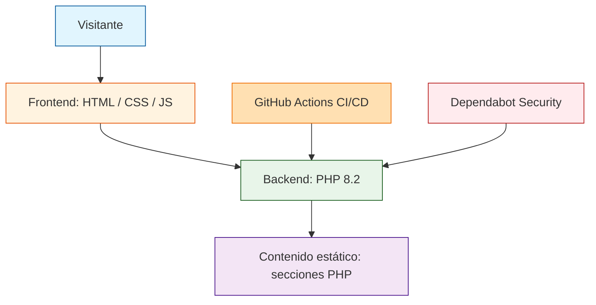

# Museo Soumaya — Sitio Web

  
  
  

Sitio web informativo del Museo Soumaya desarrollado con PHP 8.2. Incluye secciones de galerías, colecciones, exposiciones, quiénes somos, contacto y arte para todos.

---

## Descripción

Sitio web informativo del Museo Soumaya con navegación entre secciones: galerías, colecciones, exposiciones, quiénes somos, contacto y arte para todos. Proyecto académico desarrollado con PHP puro sin base de datos, ideal para presentación de contenido estático.

## Stack tecnológico

- **Backend:** PHP 8.2
- **Frontend:** HTML5, CSS3, JavaScript
- **Estilos:** Bootstrap 5 (CDN), Tailwind CSS (CDN)
- **Servidor local:** Apache (XAMPP)

## Arquitectura del sistema

---
